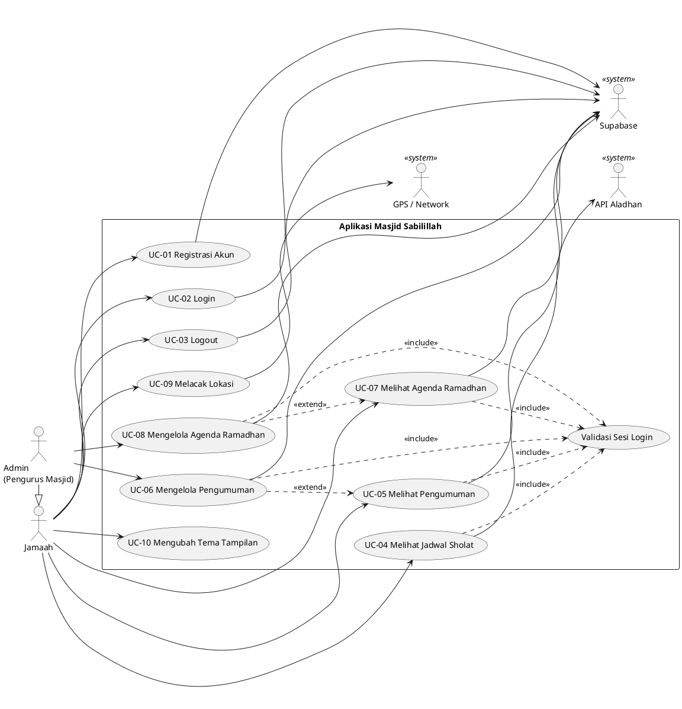

# Spesifikasi Kebutuhan — Aplikasi Masjid Sabilillah

**Bentuk spesifikasi:** Use Case Diagram + Use Case Description
**Platform:** Flutter (Android / iOS), backend Supabase, API jadwal sholat Aladhan
**Versi aplikasi:** 1.0.0+1

---

## 1. Gambaran Umum

Aplikasi Masjid Sabilillah adalah aplikasi mobile untuk jamaah dan pengurus Masjid Sabilillah. Jamaah dapat melihat jadwal sholat harian, membaca pengumuman/kajian, dan melihat agenda Ramadhan. Pengurus (admin) dapat mengelola pengumuman dan agenda Ramadhan yang tersimpan di database Supabase.

## 2. Aktor

| Aktor | Jenis | Deskripsi |
|---|---|---|
| Jamaah | Primer | Pengguna umum yang sudah memiliki akun dan login ke aplikasi. |
| Admin (Pengurus Masjid) | Primer | Pengurus masjid yang login dengan akun admin (`admin@masjid.com`). Mewarisi semua use case Jamaah. |
| Supabase | Sekunder (sistem) | Layanan autentikasi dan database (tabel `announcements`, `ramadhan_schedules`). |
| API Aladhan | Sekunder (sistem) | Layanan penyedia jadwal sholat berdasarkan kota. |
| GPS / Network Provider | Sekunder (sistem) | Sumber data lokasi perangkat. |

## 3. Use Case Diagram

Diagram ditulis dalam format PlantUML. Untuk menampilkan gambar, salin kode di bawah ke <https://www.plantuml.com/plantuml> atau gunakan ekstensi PlantUML di VS Code.

**Keterangan relasi:**
- **Generalisasi** Admin → Jamaah: Admin dapat melakukan semua yang dilakukan Jamaah.
- **«include»** Validasi Sesi Login: fitur utama hanya dapat diakses setelah sesi login valid (dicek di Splash Screen).
- **«extend»** Mengelola Pengumuman/Agenda: tombol tambah, ubah, dan hapus hanya muncul di halaman lihat jika pengguna adalah Admin.

---

## 4. Use Case Description

### UC-01 Registrasi Akun

| Item | Keterangan |
|---|---|
| Aktor | Jamaah |
| Deskripsi | Pengguna baru membuat akun menggunakan email dan password. |
| Pre-condition | Aplikasi terhubung ke internet; pengguna belum memiliki akun. |
| Post-condition | Akun baru tercatat di Supabase Auth; pengguna diarahkan ke halaman Login. |

**Alur utama:**
1. Pengguna membuka halaman Login lalu memilih "Daftar di sini".
2. Sistem menampilkan form registrasi (email, password, konfirmasi password).
3. Pengguna mengisi form dan menekan tombol Daftar.
4. Sistem memvalidasi input.
5. Sistem mengirim data registrasi ke Supabase.
6. Sistem menampilkan pesan berhasil dan mengarahkan pengguna ke halaman Login.

**Alur alternatif / pengecualian:**
- 4a. Email kosong atau format tidak valid → sistem menampilkan "Email wajib diisi" / "Email tidak valid".
- 4b. Password kurang dari 6 karakter → sistem menampilkan "Password minimal 6 karakter".
- 4c. Konfirmasi password berbeda → sistem menampilkan "Password tidak cocok".
- 5a. Email sudah terdaftar atau jaringan gagal → sistem menampilkan pesan error dari Supabase.

### UC-02 Login

| Item | Keterangan |
|---|---|
| Aktor | Jamaah, Admin |
| Deskripsi | Pengguna masuk ke aplikasi dengan email dan password. |
| Pre-condition | Pengguna sudah memiliki akun. |
| Post-condition | Sesi login tersimpan; pengguna berada di halaman Home. |

**Alur utama:**
1. Sistem menampilkan Splash Screen dan memeriksa sesi login.
2. Jika belum ada sesi, sistem menampilkan halaman Login.
3. Pengguna mengisi email dan password lalu menekan tombol Masuk.
4. Sistem memvalidasi input dan mengirim kredensial ke Supabase.
5. Supabase mengembalikan sesi yang valid.
6. Sistem menampilkan halaman Home dengan sapaan "Halo, <nama>".

**Alur alternatif / pengecualian:**
- 1a. Sesi masih aktif → sistem langsung menampilkan halaman Home (lewati langkah 2–5).
- 5a. Email/password salah → sistem menampilkan snackbar "Login Gagal" beserta pesannya.

### UC-03 Logout

| Item | Keterangan |
|---|---|
| Aktor | Jamaah, Admin |
| Deskripsi | Pengguna keluar dari akunnya. |
| Pre-condition | Pengguna sudah login. |
| Post-condition | Sesi dihapus; pengguna berada di halaman Login. |

**Alur utama:**
1. Pengguna menekan ikon Pengaturan di halaman Home.
2. Pengguna memilih menu "Logout".
3. Sistem menampilkan dialog konfirmasi.
4. Pengguna menekan "Logout".
5. Sistem mengakhiri sesi di Supabase dan menampilkan halaman Login.

**Alur alternatif:**
- 4a. Pengguna menekan "Batal" → dialog ditutup, pengguna tetap login.
- 5a. Logout gagal → sistem menampilkan snackbar "Logout Error".

### UC-04 Melihat Jadwal Sholat

| Item | Keterangan |
|---|---|
| Aktor | Jamaah, Admin |
| Deskripsi | Pengguna melihat jadwal lima waktu sholat hari ini. |
| Pre-condition | Pengguna sudah login; perangkat terhubung ke internet. |
| Post-condition | Jadwal Subuh, Dzuhur, Ashar, Maghrib, dan Isya tampil beserta tanggal. |

**Alur utama:**
1. Pengguna memilih menu "Jadwal Sholat" di Home.
2. Sistem membaca kota tersimpan di penyimpanan lokal (default: Surabaya).
3. Sistem meminta jadwal ke API Aladhan (metode 5, Kemenag).
4. Sistem menampilkan tanggal dan lima waktu sholat.

**Alur alternatif:**
- 3a. Permintaan gagal → sistem menampilkan "Gagal memuat jadwal sholat" dan tombol "Coba Lagi".

### UC-05 Melihat Pengumuman

| Item | Keterangan |
|---|---|
| Aktor | Jamaah, Admin |
| Deskripsi | Pengguna melihat daftar pengumuman/kajian masjid dan detailnya. |
| Pre-condition | Pengguna sudah login. |
| Post-condition | Daftar pengumuman tampil, diurutkan dari yang terbaru. |

**Alur utama:**
1. Pengguna memilih menu "Pengumuman" di Home.
2. Sistem mengambil data dari tabel `announcements` di Supabase.
3. Sistem menampilkan daftar pengumuman (judul, tanggal, jenis Info/Kajian).
4. Pengguna memilih salah satu pengumuman.
5. Sistem menampilkan detail (judul, isi, tanggal, nama ustadz bila jenisnya Kajian).

**Alur alternatif:**
- 2a. Data kosong → sistem menampilkan "Belum ada informasi masjid".
- 2b. Gagal mengambil data → sistem menampilkan pesan error.

### UC-06 Mengelola Pengumuman

| Item | Keterangan |
|---|---|
| Aktor | Admin |
| Deskripsi | Admin menambah, mengubah, dan menghapus pengumuman. |
| Pre-condition | Pengguna login sebagai Admin. |
| Post-condition | Data di tabel `announcements` berubah dan daftar diperbarui. |

**Alur utama (tambah):**
1. Admin membuka halaman Pengumuman.
2. Sistem menampilkan tombol "Buat Info" karena pengguna adalah Admin.
3. Admin menekan "Buat Info" lalu mengisi judul, isi, jenis (Info/Kajian), nama ustadz (untuk Kajian), dan status aktif.
4. Admin menekan "Simpan".
5. Sistem menyimpan data ke Supabase dan memperbarui daftar.

**Alur alternatif:**
- 3a. **Ubah:** Admin membuka detail pengumuman → menekan ikon edit → mengubah data → Simpan → sistem memperbarui data.
- 3b. **Hapus:** Admin membuka detail pengumuman → menekan ikon hapus → sistem meminta konfirmasi → Admin menyetujui → sistem menghapus data.
- 4a. Judul, isi, atau nama ustadz (jenis Kajian) kosong → sistem menampilkan "Judul wajib diisi" / "Konten wajib diisi".
- 5a. Gagal menyimpan → sistem menampilkan pesan error.

### UC-07 Melihat Agenda Ramadhan

| Item | Keterangan |
|---|---|
| Aktor | Jamaah, Admin |
| Deskripsi | Pengguna melihat agenda kegiatan Ramadhan (Tarawih, Takjil, Kajian). |
| Pre-condition | Pengguna sudah login. |
| Post-condition | Agenda tampil urut berdasarkan tanggal kegiatan. |

**Alur utama:**
1. Pengguna membuka halaman Pengumuman lalu memilih menu Agenda Ramadhan.
2. Sistem mengambil data dari tabel `ramadhan_schedules`.
3. Sistem menampilkan agenda: tanggal, hari Ramadhan ke-, jenis kegiatan, deskripsi, dan penanggung jawab.

**Alur alternatif:**
- 2a. Data kosong → sistem menampilkan "Belum ada jadwal".
- 2b. Gagal mengambil data → sistem menampilkan pesan error.

### UC-08 Mengelola Agenda Ramadhan

| Item | Keterangan |
|---|---|
| Aktor | Admin |
| Deskripsi | Admin menambah, mengubah, dan menghapus agenda Ramadhan. |
| Pre-condition | Pengguna login sebagai Admin. |
| Post-condition | Data di tabel `ramadhan_schedules` berubah dan daftar diperbarui. |

**Alur utama (tambah):**
1. Admin membuka halaman Agenda Ramadhan.
2. Sistem menampilkan tombol tambah (+) karena pengguna adalah Admin.
3. Admin mengisi tanggal, hari Ramadhan ke-, jenis kegiatan, deskripsi, dan penanggung jawab.
4. Admin menekan "Simpan"; sistem menyimpan data ke Supabase dan memperbarui daftar.

**Alur alternatif:**
- 3a. **Ubah:** Admin memilih ikon edit pada agenda → mengubah data → Simpan.
- 3b. **Hapus:** Admin memilih ikon hapus → sistem menampilkan konfirmasi "Hapus?" → Admin menyetujui → data dihapus.
- 4a. Gagal menyimpan → sistem menampilkan snackbar "Gagal menyimpan".

### UC-09 Melacak Lokasi

| Item | Keterangan |
|---|---|
| Aktor | Jamaah, Admin |
| Deskripsi | Pengguna melihat posisi perangkat di peta menggunakan provider GPS atau Network. |
| Pre-condition | Izin lokasi diberikan; layanan lokasi aktif. |
| Post-condition | Posisi dan jalur pergerakan tampil di peta beserta statistiknya. |

**Alur utama:**
1. Pengguna memilih menu "Lokasi Masjid" di Home.
2. Sistem menampilkan pilihan mode Statis atau Bergerak.
3. Pengguna memilih mode dan provider (GPS/Network), lalu menekan Start.
4. Sistem menampilkan posisi di peta (OpenStreetMap) beserta akurasi, jarak, dan kecepatan.
5. Pengguna menekan Stop untuk mengakhiri pelacakan.

**Alur alternatif:**
- 3a. Izin lokasi ditolak → sistem menampilkan pesan izin lokasi ditolak.
- 4a. Pengguna menekan Pause → pelacakan dijeda tanpa menghapus jalur yang sudah terekam.

### UC-10 Mengubah Tema Tampilan

| Item | Keterangan |
|---|---|
| Aktor | Jamaah, Admin |
| Deskripsi | Pengguna mengganti tampilan antara tema terang dan gelap. |
| Pre-condition | Aplikasi terbuka. |
| Post-condition | Tema berubah dan pilihan tersimpan untuk sesi berikutnya. |

**Alur utama:**
1. Pengguna membuka halaman Pengaturan.
2. Pengguna menggeser switch "Tema Gelap".
3. Sistem langsung mengganti tema dan menyimpan pilihan ke penyimpanan lokal (SharedPreferences).

**Alur alternatif:**
- 3a. Gagal menyimpan → sistem mengembalikan tema ke kondisi sebelumnya.

---

## 5. Kebutuhan Non-Fungsional

| Kode | Kebutuhan |
|---|---|
| NFR-01 | Aplikasi berjalan di Android dan iOS. |
| NFR-02 | Kredensial Supabase disimpan di file `.env`, tidak ditulis langsung di kode. |
| NFR-03 | Tampilan responsif untuk ponsel dan tablet (lebar ≥ 600 px). |
| NFR-04 | Tersedia tema terang dan gelap. |
| NFR-05 | Setiap kegagalan jaringan menampilkan pesan yang dapat dipahami pengguna. |

## 6. Batasan dan Pengembangan Berikutnya

Fitur berikut sudah tampil sebagai menu atau dependensi, tetapi **belum diimplementasikan** sehingga tidak dimasukkan ke dalam use case di atas:

- **Donasi** — menu dan halaman informasi sudah ada, tetapi proses donasi/pembayaran belum dibuat.
- **Notifikasi pengingat sholat/pengumuman** — dependensi Firebase Messaging dan Local Notifications sudah ditambahkan, logika belum dibuat.
- **Pemilihan kota jadwal sholat** — kota dibaca dari penyimpanan lokal, tetapi belum ada tampilan untuk mengubahnya.
